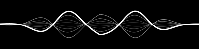

# unknown-pleasures



Voice-reactive OSD for [voxtype](https://voxtype.io) push-to-talk dictation:
a black 400×100 panel on the focused monitor while recording, frozen during
transcription, hidden when idle. Two renderers, chosen by the `STYLE`
constant in `unknown_pleasures.py`:

- **`"siri"`** (default) — the classic Siri wave: one bold carrier line with
  thinner mirrored echoes sharing its zero-crossings, pinched at the edges,
  beating and traveling while you speak. Loudness sets the swing; spectral
  balance sets the oscillation count and travel speed (bass rolls wide and
  slow, sibilants shiver fast and tight). Straight still line at silence.
- **`"waves"`** — five independent full-width lines, each riding its own
  frequency band (85 Hz–3.8 kHz split log-evenly; bass = brightest line).
- **`"ridgeline"`** — Joy Division *Unknown Pleasures* stacked ridgelines
  driven by the loudness envelope.

## How it works

- voxtype's daemon serves 16-byte audio frames (u32 seq, f32 min, f32 max,
  f32 peak dBFS, native order, 100 Hz) on `$XDG_RUNTIME_DIR/voxtype/audio.sock`
  — but only while recording, so frame flow doubles as the show/hide signal.
- Those frames carry loudness only, so for the waves style the overlay opens
  its own PipeWire mic tap (`pw-record --raw`, a second consumer alongside
  voxtype) **only while a recording is active**, and splits a 64 ms FFT window
  into the per-line bands. The tap is killed the moment recording ends; the
  mic is never held open while idle. If the tap fails, all lines fall back to
  the loudness envelope.
- Rendering is Cairo on a GTK4 + gtk4-layer-shell surface. The ridgeline
  style uses fill-to-bottom occlusion — the album's signature overlap.
- `$XDG_RUNTIME_DIR/voxtype/state` (`idle`/`recording`/`transcribing`) keeps
  the last shape frozen on screen while Whisper transcribes.
- The stock voxtype OSD is disabled (`[osd] enabled = false` in
  `~/.config/voxtype/config.toml`); this replaces it.

## Requirements

- [voxtype](https://voxtype.io) (AUR: `voxtype-bin`) — the dictation daemon
  this visualizes
- A Wayland compositor with layer-shell (Hyprland, Sway, River, …)
- `python-gobject`, `python-numpy`, `gtk4-layer-shell`, PipeWire (`pw-record`)

```bash
# Arch
sudo pacman -S python-gobject python-numpy gtk4-layer-shell pipewire
```

## Install

```bash
git clone <this repo> && cd unknown-pleasures
./install.sh
```

The installer copies the script to `~/.local/bin/unknown-pleasures`,
generates and enables the systemd user unit, and starts it. Re-run it to
update. Then two one-time steps:

1. **Disable voxtype's built-in OSD** in `~/.config/voxtype/config.toml`
   (this replaces it — both read the same audio socket):

   ```toml
   [osd]
   enabled = false
   ```

2. **Push-to-talk keybinds** (Hyprland example — hold to record, release to
   transcribe; the overlay appears while recording):

   ```
   bind = SUPER, H, exec, voxtype record start
   bindr = SUPER, H, exec, voxtype record stop
   ```

Uninstall: `systemctl --user disable --now unknown-pleasures` and delete
`~/.local/bin/unknown-pleasures` plus the unit file.

**Gotcha:** with Python bindings, gtk4-layer-shell must be `LD_PRELOAD`ed
so it hooks GTK before the first Wayland surface exists — the generated
unit handles this; running the script bare without it gives "GtkWindow is
not a layer surface" and a normal floating window.

## Tuning

Constants at the top of `unknown_pleasures.py`. Shared: `STYLE`,
`BOTTOM_MARGIN` (396 px — vertical position, matches the old swayosd band on
a 1440p monitor), `WIDTH`/`HEIGHT`, `FPS`.

Siri style — the wave is a standing pattern: a crest anchored dead-center,
mirrored lobes falling away symmetrically, no lateral travel. Voice pumps
the height per syllable, the spectrum reshapes it spatially (bass = center,
treble = flanks), ripples radiate outward from the middle, and a small
amplitude floor keeps it faintly undulating even in silence ("listening").

| Knob | Default | Meaning |
|---|---|---|
| `SIRI_HALF` | 44 px | half-height of the loudest swing |
| `SIRI_BOOST` | 1.9 | raise if your voice doesn't fill the panel |
| `SIRI_DECAY_TAU` | 0.11 s | syllable pump; raise toward 0.18 for calmer |
| `SIRI_SPECTRUM` | 0.75 | how strongly the voice spectrum reshapes the wave |
| `SIRI_IDLE` | 0.15 | idle amplitude floor — 0 = dead still at silence |
| `SIRI_RIPPLE`/`SIRI_RIPPLE_K` | 0.45 / 2.2 | outward bloom depth / tightness |
| `SIRI_SWAY` | 0.3 rad | lobe sway around the center anchor |
| `SIRI_PERIODS` | 3.0 | lobe count across the width |
| `SIRI_LAG_MAX` | 0.55 rad | echo stagger |
| `SIRI_LINES` | — | echo set: scale, width, alpha, driving band |

Rendering runs on the GTK frame clock — i.e. at the monitor's refresh rate
(155 Hz on DP-2) — and all motion is time-based, so it looks the same at any
refresh. `STATE_HZ` (30) only paces the show/hide/freeze state machine.
Costs roughly a fifth of one core while visible, nothing while hidden.

Waves style:

| Knob | Default | Meaning |
|---|---|---|
| `N_LINES` | 5 | one line per frequency band |
| `BAND_LO`/`BAND_HI` | 85 / 3800 Hz | analysed voice range |
| `AMP_MAX` | 38 px | tallest swing of the loudest band |
| `NOISE_GATE_DB` | −56 dBFS | per-band gate (true dBFS amplitude) — raise (e.g. −46) if room noise wiggles the lines, lower if quiet speech barely moves them |
| `GATE_RANGE_DB` | 38 dB | gate..gate+range maps onto 0..1 swing |
| `WAVE_PERIODS`/`WAVE_SPEED` | — | spatial periods / drift speed per line |
| `EDGE_FLOOR` | 0.35 | swing kept at the panel edges (lines move full-width) |
| `RELEASE` | 0.86 | decay per tick — lower = lines still faster after speech |

Ridgeline style: `GAIN` (9.0, envelope gain), `N_ROWS`/`N_PTS` (12/72),
`ROW_PERIOD` (0.22 s per line), `PEAK_MAX` (34 px), `FLAT_MARGIN` (0.12).
